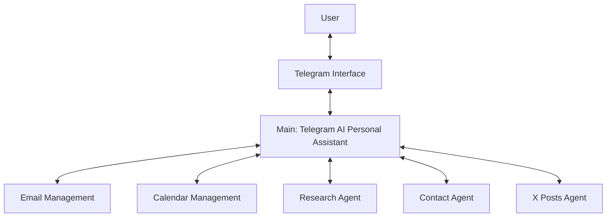

# Workflow Architecture

## 1. Overview

The Telegram AI Personal Assistant uses a modular workflow architecture built in n8n.

The system consists of:

- One main workflow: **Telegram AI Personal Assistant**.
- Five specialized sub-workflows: Email, Calendar, Research, Contacts, and X Posts.

The main workflow coordinates user requests. Each sub-workflow is responsible for a particular category of task.

This structure separates the user interface and request-routing logic from the individual automation tasks.

## 2. High-Level Architecture

This diagram represents the intended logical design. The actual execution paths, node connections, and data mappings must be confirmed against the current n8n workflow exports.

## 3. Main Workflow

### Telegram AI Personal Assistant

**Primary responsibility:** Receive user requests, coordinate task execution, and return responses.

The main workflow serves as the entry point for the assistant. It receives requests through the configured Telegram integration and processes them using the AI components and routing logic present in the workflow.

The intended process is:

1. A user sends a request through Telegram.
2. The main workflow receives and interprets the request.
3. The workflow routes the request to the appropriate sub-workflow.
4. The selected sub-workflow performs its configured task.
5. The result is returned to the main workflow.
6. The assistant responds through Telegram.

Voice requests depend on the voice-message handling and transcription components present in the current version of the workflow.

## 4. Sub-Workflows

### Email Management Sub-Workflow

**Responsibility:** Handle email-related requests.

This workflow contains the email operations configured in its nodes and uses the associated email credentials.

The precise actions supported should be confirmed from the current export and tested before live use.

### Calendar Management Sub-Workflow

**Responsibility:** Handle calendar-related requests.

This workflow uses the configured calendar integration to carry out the operations implemented in its nodes.

Calendar tests should verify the target calendar, timezone, date, start time, and end time.

### Research Agent Sub-Workflow

**Responsibility:** Support research and information-gathering requests.

This workflow uses the sources and integrations configured in the current export. Sources used in earlier versions included Wikipedia and Hacker News, but the current JSON should be treated as the source of truth for the active configuration.

### Contact Agent Sub-Workflow

**Responsibility:** Handle contact-related operations.

The project uses Google Sheets for configured contact data. The target spreadsheet, worksheet, column structure, and supported operations must be checked in the workflow.

### X Posts Agent Sub-Workflow

**Responsibility:** Handle X-post-related operations.

The project uses Google Sheets for configured X-post data. The exact workflow behavior must be confirmed before assuming that it only drafts content or performs live publishing.

## 5. Request Routing

The main workflow acts as the coordinator between Telegram and the task-specific workflows.

The intended routing relationship is:

| Request category | Destination |
|---|---|
| Email | Email Management Sub-Workflow |
| Calendar or event | Calendar Management Sub-Workflow |
| Research or information gathering | Research Agent Sub-Workflow |
| Contact-related task | Contact Agent Sub-Workflow |
| X-post-related task | X Posts Agent Sub-Workflow |

Routing depends on the main workflow's actual AI instructions, conditions, and sub-workflow call nodes.

## 6. Data Flow

For the architecture to work correctly, the main workflow and each sub-workflow must agree on the input and output data.

For every sub-workflow call, verify:

- The main workflow passes the required input fields.
- Field names and data types match what the sub-workflow expects.
- The sub-workflow trigger is compatible with the way it is invoked.
- The sub-workflow returns the data expected by the main workflow.
- Errors can be identified in the n8n execution history.

When importing into a different n8n instance, do not assume that workflow IDs, credentials, or resource references remain valid.

## 7. Error Handling

The project has included shared error-handling logic in its workflow design.

Review the current exports to verify where the error handler is connected and which errors it processes.

A useful error-handling approach should:

- Make failed executions easier to diagnose.
- Preserve enough technical context to troubleshoot the failure.
- Avoid exposing API keys, tokens, private messages, or other sensitive information.
- Provide an appropriate user-facing response when an operation cannot be completed.

Test error handling using a controlled failure that does not affect production data.

## 8. Why This Architecture?

The modular design provides several benefits:

- **Separation of responsibilities:** Each sub-workflow focuses on one task category.
- **Maintainability:** A task can be updated and tested independently.
- **Troubleshooting:** Developers can inspect executions for the main workflow and the relevant sub-workflow.
- **Reusability:** Sub-workflows may be reused in other workflows when their inputs and triggers are compatible.
- **Clarity:** The Telegram-facing interface remains separate from the implementation of individual tasks.

## 9. Configuration and Deployment

The repository documents the design and stores sanitized workflow exports.

The running n8n instance remains responsible for executing the automations. Importing files into GitHub does not deploy them to n8n.

Before deployment, verify credentials, resource selections, sub-workflow references, input/output mappings, and error-handling behavior.

## 10. Source of Truth

This document describes the intended architecture. The actual node-level behavior is defined by the current n8n workflow exports.

If the documentation and workflow JSON disagree, inspect the current workflow and update this document to reflect the implemented behavior.
