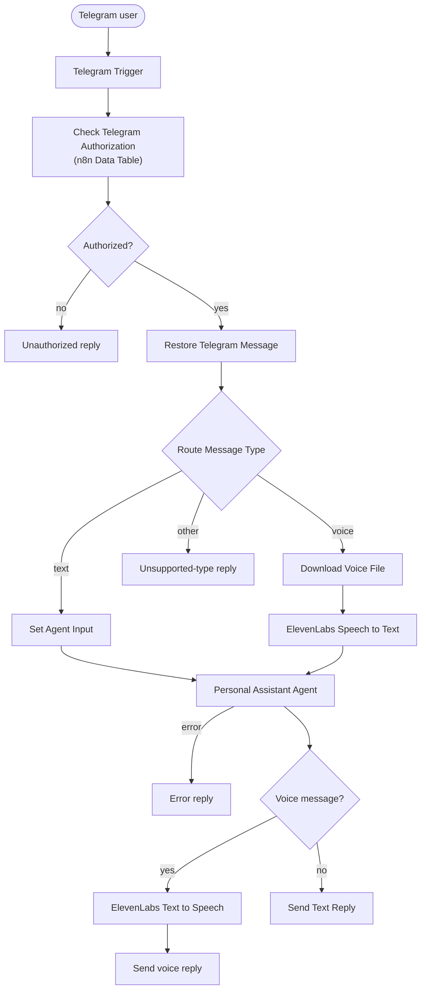
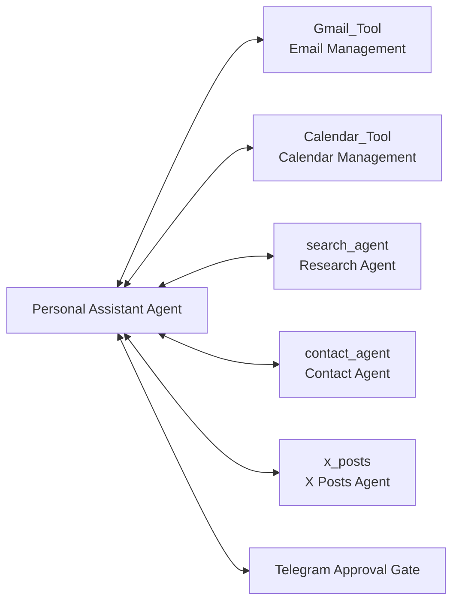
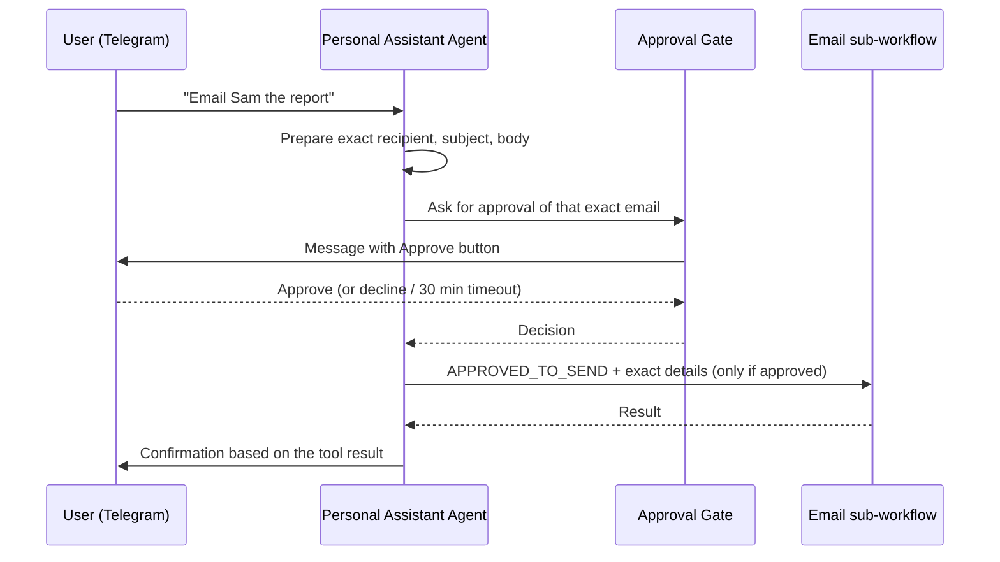

# Workflow Architecture

## 1. Overview

The Telegram AI Personal Assistant is built from six n8n workflows:

- One **main workflow** (`telegram-ai-personal-assistant.json`) that receives Telegram messages, checks who is allowed to use the bot, handles text and voice, and runs a single AI agent.
- Five **sub-workflows** that the agent calls as tools: Email, Calendar, Research, Contacts, and X Posts. Each one has its own AI agent (or, for Contacts, plain nodes) and its own tools.

All AI agents use Google Gemini (`models/gemini-3.5-flash-lite`, temperature 0.2, up to 2048 output tokens).

## 2. Main workflow flow

Key points:

1. **Authorization first.** Every message is checked against a Data Table of `chat_id` values with `status = active`. Anyone else gets a refusal and nothing else runs.
2. **Text, voice, or unsupported.** Text goes straight to the agent. Voice messages are downloaded and transcribed with ElevenLabs first. Anything else (photos, stickers, and so on) gets a short "only text and voice" reply.
3. **One agent, many tools.** The Personal Assistant Agent has a 4-message window memory keyed by Telegram chat ID, the five sub-workflow tools, and the Telegram Approval Gate.
4. **Reply in the same format.** Voice requests are answered with a voice message; text requests with text.
5. **Errors.** If the agent fails, the user receives "Sorry, something went wrong while handling that. Please try again."

## 3. Agent tools

| Tool | Sub-workflow | What it does |
|---|---|---|
| `Gmail_Tool` | Email Management | Searches and reads Gmail, summarizes and prioritizes emails, saves drafts, sends emails and replies, manages read state and labels. Ten Gmail operations in total. |
| `Calendar_Tool` | Calendar Management | Gets events, checks availability, creates events (with or without attendees), updates and deletes events in Google Calendar. |
| `search_agent` | Research Agent | Answers research questions using Wikipedia and Hacker News only. It does not do live web search. |
| `contact_agent` | Contact Agent | `get` looks up a contact by name, email, or phone in a Google Sheet; `add` saves a contact (matched on phone number). |
| `x_posts` | X Posts Agent | Writes X (Twitter) post drafts and saves them to a Google Sheet. It never publishes to X. |
| Telegram Approval Gate | (main workflow) | Sends the user an **Approve** button in Telegram and waits up to 30 minutes for the decision. |

## 4. Human approval

Reading, searching, summarizing, and drafting never need approval. These actions do:

- Sending a new email or a reply
- Creating, updating, or deleting a calendar event
- Saving a new contact
- Publishing an X post (not currently possible; the workflow only saves drafts)

The agent is instructed to call the Approval Gate with the exact action, wait for the user, and only then call the sub-workflow:

The Email sub-workflow adds a second layer: its agent only calls `sendEmail` or `sendReply` when the request begins with `APPROVED_TO_SEND` or `APPROVED_TO_REPLY`.

> **Limitation:** both layers are enforced through AI instructions, not through workflow logic. A prompt-injected email could try to talk the model into sending. If you need a stricter guarantee, add a workflow-level check (for example an IF node) that verifies the approval result before the send operation runs.

## 5. Sub-workflow design

| Sub-workflow | Trigger input | Internals |
|---|---|---|
| Email Management | `query` text | AI agent with 10 Gmail tools |
| Calendar Management | `query` text | AI agent with 6 Google Calendar tools |
| Research Agent | `query` text | AI agent with Wikipedia and Hacker News tools; failures return a plain-language error message |
| Contact Agent | `action`, `name`, `email`, `phone` | No AI. An IF node routes `add` to an append-or-update on the sheet; anything else reads the sheet and a Code node filters the matching rows. |
| X Posts Agent | `query` text | AI agent with a `savePost` Google Sheets tool; success and error response nodes |

Each sub-workflow starts with an *Execute Workflow Trigger*, so it can only be called from another workflow.

## 6. Error handling

- The main agent and the Email, Calendar, Research, and X Posts agents each have an error output that produces a plain-language failure message.
- The calendar agent is also instructed never to report success unless the tool response confirms it.
- The Contact Agent has no AI agent, so it has no error output beyond a "no matching contact" result.
- There is no shared error-handler workflow in this repository.

## 7. Security model

- A Data Table allow-list restricts the bot to approved Telegram chats.
- The approval gate only accepts a decision from the person who sent the request (`approverIds` is the sender's Telegram ID).
- Credentials live in n8n's credential store, not in the exported JSON.
- All exports are sanitized and set to inactive. See [SECURITY.md](../SECURITY.md).

## 8. Why this design?

- **Separation of responsibilities:** each sub-workflow does one kind of task and can be tested on its own.
- **Maintainability:** the Telegram interface, the routing agent, and the task logic can change independently.
- **Reusability:** sub-workflows can be called from other workflows that send compatible inputs.
- **Troubleshooting:** n8n shows the main execution and each sub-workflow execution separately.

## 9. Source of truth

The workflow JSON files in [`workflows/`](../workflows/) are the source of truth. If this document and a workflow disagree, trust the JSON and update this document.
